# 🍽️ CampusEats Catalogue

A REST API-based food catalogue web application built using **Node.js and Express.js**, with an interactive HTML and CSS frontend.

The application allows users to view dishes, add new dishes, delete existing dishes, and filter food items based on vegetarian and non-vegetarian categories.

---

## 📌 Project Information

| Detail | Information |
|---|---|
| Course | CS543 – Web Services |
| Institute | IIIT Vadodara |
| Project | Node & Express Tutorial |
| Application | CampusEats Catalogue |
| Backend | Node.js + Express.js |
| Frontend | HTML, CSS, JavaScript |
| Data Storage | In-Memory Array |

---

## ✨ Features

- Display all available dishes.
- Retrieve a single dish using its ID.
- Add new dishes using POST API.
- Delete dishes using DELETE API.
- Filter vegetarian dishes.
- Filter non-vegetarian dishes.
- REST API with HTTP status codes.
- Responsive frontend interface.
- JSON-based client-server communication.

---

## 🛠️ Technologies Used

| Technology | Purpose |
|---|---|
| Node.js | JavaScript Runtime |
| Express.js | Backend Framework |
| HTML5 | Frontend Structure |
| CSS3 | Styling |
| JavaScript | Frontend Functionality |
| REST API | Client-Server Communication |
| JSON | Data Exchange |
| Git & GitHub | Version Control |

---

## 📁 Project Structure

```text
CS543-CampusEats-Catalogue/
│
├── public/
│   ├── index.html
│   └── style.css
│
├── screenshots/
│   ├── 1_home1.png
│   ├── 1_home2.png
│   ├── 2-veg-filter.png
│   ├── 3-nonveg-filter.png
│   ├── 4-add-dish_cmd.png
│   ├── 4-add-dish_UI.png
│   ├── 5-delete-dish_cmd.png
│   ├── 5-delete-dish-vegthali_UI.png
│   ├── 6-get-api_cmd.png
│   ├── 6-get-api_json.png
│   ├── 7-post-api_cmd.png
│   ├── 7-post-api_UI.png
│   ├── 8-get-notfound-404-cmd.png
│   └── 8-get-wrong-url.png
│
├── server.js
├── package.json
├── package-lock.json
├── .gitignore
└── README.md
```

---

## ⚙️ Installation and Setup

### 1. Clone Repository

```bash
git clone https://github.com/swedinesh/CS543-CampusEats-Catalogue.git
```

### 2. Navigate to Project

```bash
cd CS543-CampusEats-Catalogue
```

### 3. Install Dependencies

```bash
npm install
```

### 4. Start Express Server

```bash
node server.js
```

### 5. Open Application

```text
http://localhost:3000
```

---

## 🔗 REST API Endpoints

| HTTP Method | Endpoint | Description |
|---|---|---|
| GET | `/items` | Retrieve all dishes |
| GET | `/items/:id` | Retrieve a single dish |
| POST | `/items` | Add a new dish |
| DELETE | `/items/:id` | Delete a dish |
| GET | `/items?veg=true` | Retrieve vegetarian dishes |
| GET | `/items?veg=false` | Retrieve non-vegetarian dishes |

---

## 📊 HTTP Status Codes

| Status Code | Description |
|---|---|
| 200 | OK |
| 201 | Created |
| 204 | No Content |
| 404 | Not Found |
| 422 | Unprocessable Entity |

---

# 📸 Application Screenshots

### 1. CampusEats Homepage

**Homepage – Screenshot 1**

[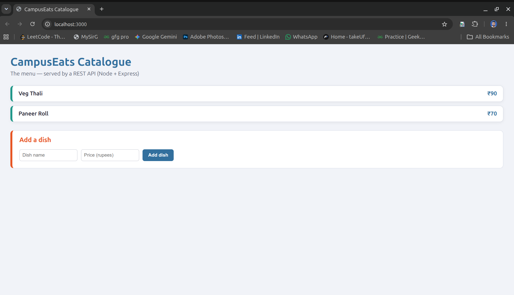](screenshots/1_home1.png)

[🔍 Open Full Screenshot](screenshots/1_home1.png)

**Homepage – Screenshot 2**

[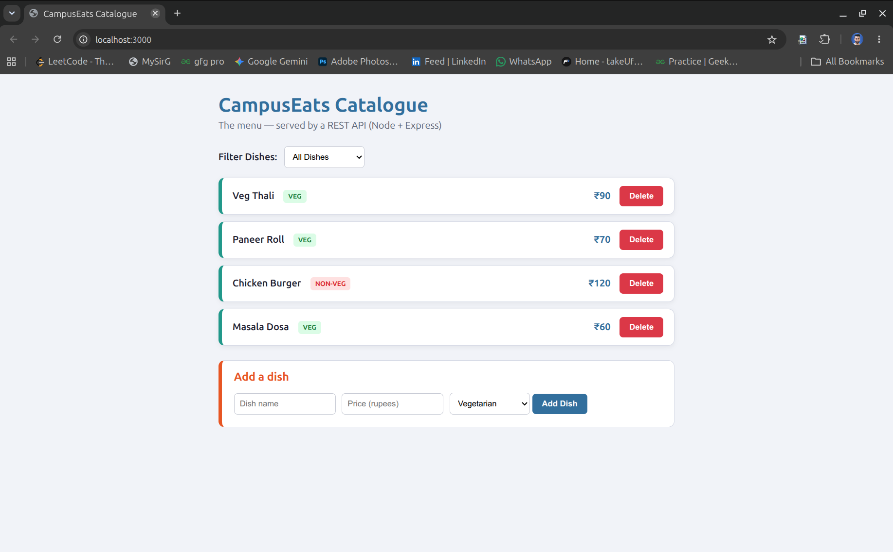](screenshots/1_home2.png)

[🔍 Open Full Screenshot](screenshots/1_home2.png)

---

### 2. Vegetarian Filter

[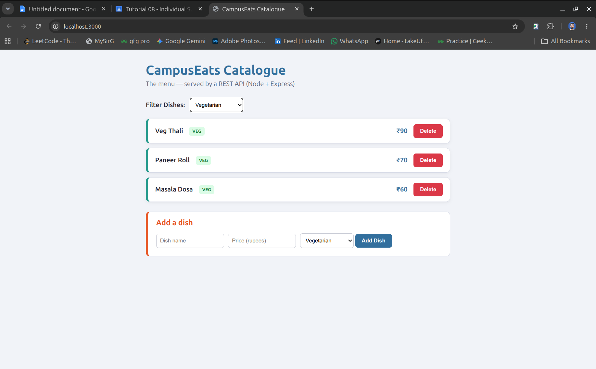](screenshots/2-veg-filter.png)

[🔍 Open Full Screenshot](screenshots/2-veg-filter.png)

---

### 3. Non-Vegetarian Filter

[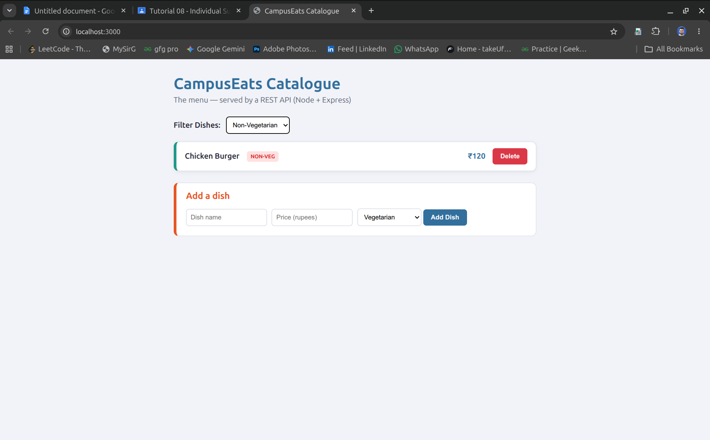](screenshots/3-nonveg-filter.png)

[🔍 Open Full Screenshot](screenshots/3-nonveg-filter.png)

---

### 4. Add New Dish

**API Command**

[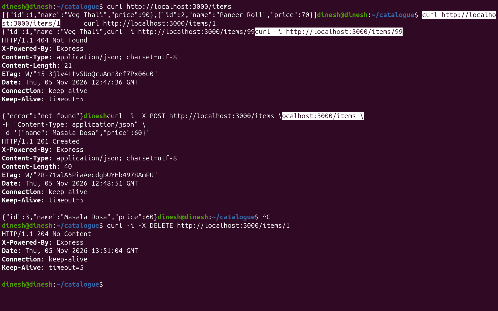](screenshots/4-add-dish_cmd.png)

[🔍 Open Full Screenshot](screenshots/4-add-dish_cmd.png)

**Application Interface**

[](screenshots/4-add-dish_UI.png)

[🔍 Open Full Screenshot](screenshots/4-add-dish_UI.png)

---

### 5. Delete Dish

**API Command**

[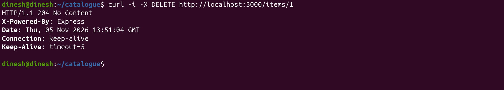](screenshots/5-delete-dish_cmd.png)

[🔍 Open Full Screenshot](screenshots/5-delete-dish_cmd.png)

**Application Interface**

[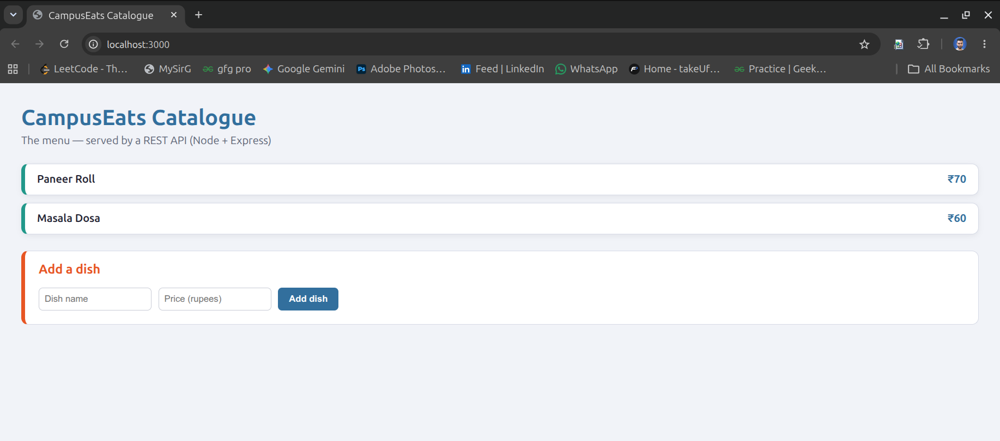](screenshots/5-delete-dish-vegthali_UI.png)

[🔍 Open Full Screenshot](screenshots/5-delete-dish-vegthali_UI.png)

---

# 🧪 API Testing Screenshots

### 6. GET API – Retrieve All Dishes

**Command**

[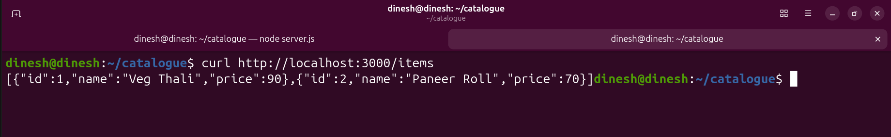](screenshots/6-get-api_cmd.png)

[🔍 Open Full Screenshot](screenshots/6-get-api_cmd.png)

**JSON Response**

[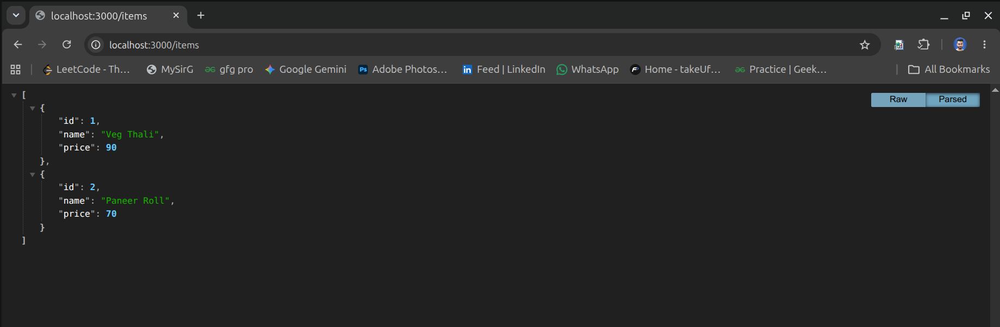](screenshots/6-get-api_json.png)

[🔍 Open Full Screenshot](screenshots/6-get-api_json.png)

---

### 7. POST API – Add New Dish

**Command**

[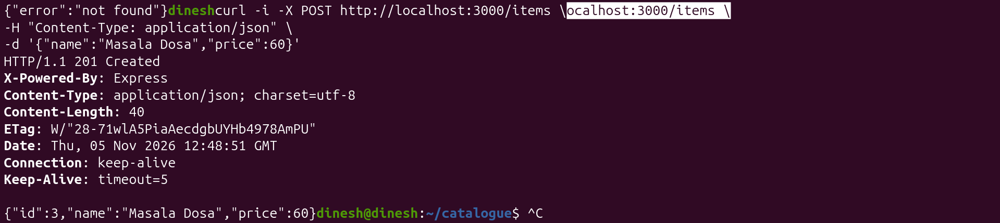](screenshots/7-post-api_cmd.png)

[🔍 Open Full Screenshot](screenshots/7-post-api_cmd.png)

**Response / Application**

[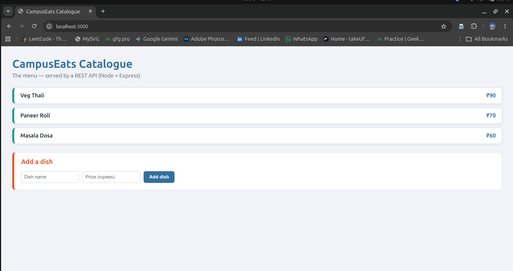](screenshots/7-post-api_UI.png)

[🔍 Open Full Screenshot](screenshots/7-post-api_UI.png)

---

### 8. Error Handling – 404 Not Found

**Invalid Item ID**

[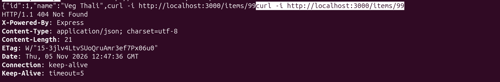](screenshots/8-get-notfound-404-cmd.png)

[🔍 Open Full Screenshot](screenshots/8-get-notfound-404-cmd.png)

**Wrong URL**

[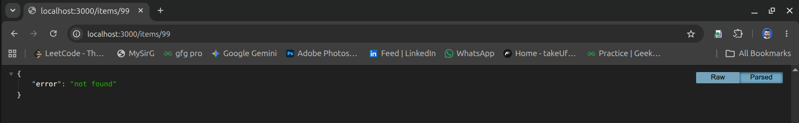](screenshots/8-get-wrong-url.png)

[🔍 Open Full Screenshot](screenshots/8-get-wrong-url.png)

---

## 🏗️ Application Architecture

```text
       CLIENT (Browser)
              |
              |
         HTTP Requests
              |
              v
      REST API (Express.js)
              |
              |
       Route Handling
              |
              v
       In-Memory Array
              |
       ----------------
       |      |       |
      GET    POST   DELETE
       |      |       |
       ----------------
              |
              v
        JSON Response
              |
              v
       CLIENT (Browser)
```

---

## 💾 Data Storage

This project uses an in-memory JavaScript array to store food items.

The application does not use a permanent database in this version.

**Note:** Data changes are lost when the Express server restarts because the data is stored in memory.

---

## 🚀 Future Scope

- Integrate MongoDB or PostgreSQL.
- Implement PUT and PATCH APIs.
- Add user authentication.
- Add update functionality for existing dishes.
- Improve menu management features.

---

## 👨‍💻 Author

**Dinesh Kushwaha**

MCA Student | IIIT Vadodara

---

**Course:** CS543 – Web Services  
**Project:** CampusEats Catalogue  
**Built with Node.js and Express.js**